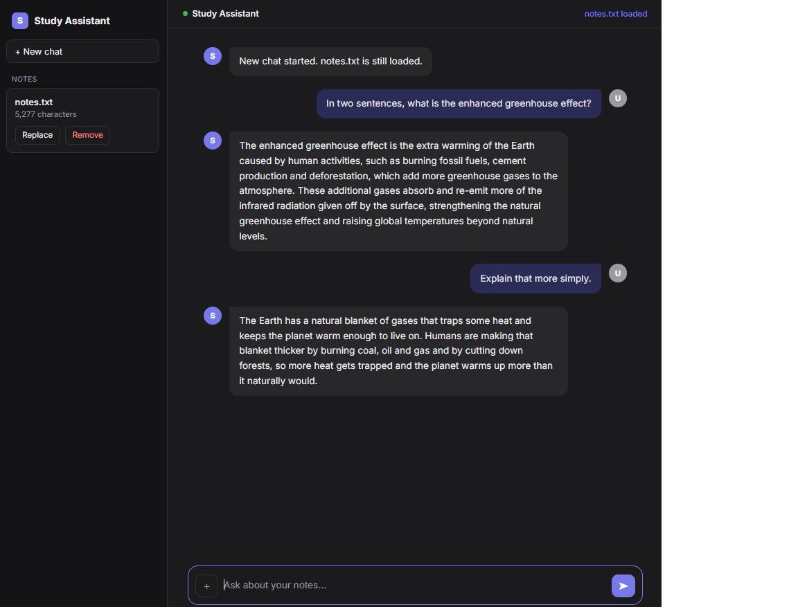

# Study Assistant

A command-line study assistant that answers questions from your own lecture notes using the Claude API. Paste your notes into a text file, ask questions in the terminal, and get exam-focused answers grounded in your material. It remembers the conversation, so follow-ups like "explain that more simply" work.



## Features

- Answers questions using your own `notes.txt` as the main source
- Says so when the notes don't cover a question, then falls back to general knowledge
- Conversation memory: follow-up questions work (keeps the last 10 exchanges)
- Clear error messages for problems like a bad API key, no internet, or low credit
- Plain-text output that reads cleanly in a terminal
- API key kept out of the code and out of Git (loaded from a `.env` file)

## Setup

You need Python 3.9 or newer and an Anthropic API key from [console.anthropic.com](https://console.anthropic.com/).

1. Clone the repo and move into it:
```
   git clone https://github.com/BUYANISHABALALA/study-assistant.git
   cd study-assistant
```

2. Create and activate a virtual environment:
```
   python -m venv .venv
   .\.venv\Scripts\Activate.ps1
```
   On Mac/Linux, use `source .venv/bin/activate` instead.

3. Install the dependencies:
```
   pip install anthropic python-dotenv
```

4. Create a file named `.env` in the project folder containing your key:
```
   ANTHROPIC_API_KEY=your-key-here
```

5. Create a file named `notes.txt` in the same folder and paste in your lecture notes.

## Usage

```
python study_assistant.py
```

Type a question and press Enter. Commands:

| Command | What it does |
|---------|--------------|
| `clear` | Forgets the conversation and starts fresh (notes stay loaded) |
| `exit`  | Quits the program |

## How it works

The script reads `notes.txt` and includes it in the system prompt, so the model answers from your material. The API itself has no memory, so the script keeps a list of recent messages and sends it with every question, which is what makes follow-up questions work. API errors are caught and turned into one-line messages instead of crashes.

## Security

`.env` and `notes.txt` are listed in `.gitignore`, so your key and your notes are never committed. Never put an API key directly in the code.

## Roadmap

- [x] CLI version with notes-based Q&A
- [x] Conversation memory and error handling
- [x] Flask web interface with file upload
- [ ] Quiz generation from notes
- [ ] Dockerize the app
- [ ] CI/CD pipeline with GitHub Actions

## Tech

Python, Anthropic API, python-dotenv, Git/GitHub
